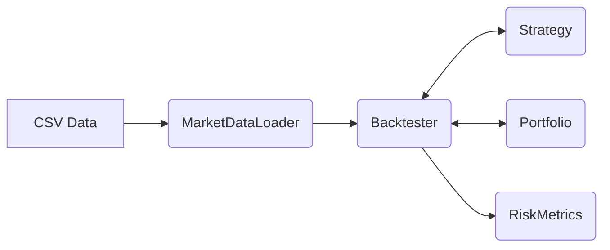

# C++ Algorithmic Trading Engine

[](https://sourya-trading-engine.vercel.app)


A single-threaded historical backtesting engine for quantitative trading strategies, written entirely in modern C++17 with zero external dependencies.

I built this project to deepen my understanding of systems engineering, memory management, and financial software design. It demonstrates how to architect a modular system that cleanly separates data ingestion, strategy execution, state management, and post-trade analytics.

## 🌐 Live Interactive Web Demo

👉 **Live Demo Site**: **[https://sourya-trading-engine.vercel.app](https://sourya-trading-engine.vercel.app)**

The [browser demo](demo/index.html) runs JavaScript calculations and a scripted terminal emulator. It does not execute the C++ binary, compile code, or run CTest. Browser results are not evidence of native engine performance. The C++ CLI implements SMA and RSI; Bollinger Bands and MACD are additional JavaScript demo strategies.

- **Interactive Strategy Workbench**: Run real-time backtests on **SMA Crossover**, **RSI Mean Reversion**, **Bollinger Bands**, and **MACD Momentum** with customizable capital, commission rates, and position sizing.
- **Streaming Live Visualizer**: Stream simulated bars sequentially at 1x–10x playback speed with play/pause and single-step inspection.
- **Browser Analytics Dashboard**: Simulated portfolio metrics including Annualized Return, Sharpe Ratio, Sortino Ratio, Maximum Drawdown, Profit Factor, Win Rate, and Expectancy.
- **Retina Canvas Charts**: Custom high-DPI Candlestick & Indicator charts with interactive crosshair HUD, Buy/Sell execution markers, and underwater drawdown curve.
- **C++ CLI Terminal Emulator**: Interactive terminal simulating binary execution (`./trading_engine`, `ctest`, `make`) right in the browser.
- **Architecture & Systems Inspector**: Click-to-inspect component explorer explaining memory management, lookahead prevention, and cache locality.

```bash
# View the interactive demo locally:
python3 -m http.server 8088 --directory demo
# Then open http://localhost:8088 in your browser, or directly open demo/index.html
```

## System Architecture

The engine is designed as a single-threaded backtester that processes historical data sequentially. This guarantees deterministic results, avoids the complexity of deadlocks typical in live-trading simulations, and makes the control flow easy to inspect. No native throughput benchmark is currently provided.



- **MarketDataLoader**: Parses historical CSV data into memory-efficient structs.
- **Strategy**: An abstract base class for algorithms. Computes indicators (SMA, RSI) and yields `BUY`, `SELL`, or `HOLD` signals.
- **Portfolio**: A state machine that tracks cash balances, executes simulated trades, deducts commissions, and marks positions to market.
- **RiskMetrics**: Post-hoc analytics engine calculating portfolio metrics (Sharpe Ratio, Max Drawdown, Profit Factor).

## Key Features

- **Zero Dependencies**: Built strictly with the C++ Standard Library. No external libraries required for CSV parsing, testing, or building.
- **Pluggable Strategies**: New strategies can be added by simply inheriting from the `Strategy` base class and implementing the `evaluate()` method.
- **Built-in Indicators**: Includes from-scratch implementations of standard technical indicators like Simple Moving Averages and Relative Strength Index.
- **Portfolio Metrics**: Accurately tracks equity curves and trade histories to compute annualized returns, win rates, and drawdowns.
- **Unit Tested**: Includes a custom lightweight test suite verifying indicator math and portfolio accounting logic.

## Building and Running

The project uses CMake and requires a compiler supporting C++17.

```bash
# Clone the repository
git clone https://github.com/Sourya-Prabaharan/Automated-Stock-Trading-Machine.git
cd Automated-Stock-Trading-Machine

# Build the engine and tests
cmake -S . -B build -DCMAKE_BUILD_TYPE=Debug
cmake --build build
cd build

# Run the tests
ctest --output-on-failure

# Run a backtest using sample data
./trading_engine ../data/sample_prices.csv --strategy sma
```

*Alternatively, you can run the provided example script from the project root:*
`./examples/run_backtest.sh`

## Output Example

```text
Loading market data from ../data/sample_prices.csv...
Loaded 260 price bars.
Running backtest with SMA Crossover (10/30)...

==================================================
BACKTEST RESULTS: SMA Crossover (10/30)
==================================================
Initial Capital:  $100000.00
Final Value:      $100761.46
Total Return:     0.76%
B&H Benchmark:    31.10%
Annualized Ret:   0.74%
Max Drawdown:     2.19% (99 bars)
Sharpe Ratio:     0.31

Trade Statistics:
Total Trades:     4
Winning Trades:   3
Losing Trades:    1
Win Rate:         75.00%
Average Win:      $559.69
Average Loss:     $852.28
Profit Factor:    1.97
==================================================
```


## What I Learned

- **Decoupling State from Logic**: Separating the raw data (`PriceBar`), the math functions (`Indicators::sma`), and the orchestration (`Backtester`) makes the system much easier to test and reason about.
- **C++ Memory & Lifetimes**: Using standard library containers and smart pointers correctly to avoid memory leaks while maintaining high throughput.
- **CMake Mastery**: Writing a clean `CMakeLists.txt` that automatically discovers sources, configures compiler flags, and integrates with CTest.
- **Financial Math Accuracy**: Dealing with floating-point precision when calculating PnL, tracking commissions, and avoiding look-ahead bias in the backtesting loop.

## Documentation

- [Architecture Notes](docs/architecture.md)
- [Design Decisions](docs/interview-notes.md)

## Scope and limitations

The built executable uses [Strategy.cpp](src/Strategy.cpp), [Backtester.cpp](src/Backtester.cpp), [Portfolio.cpp](src/Portfolio.cpp), and [RiskMetrics.cpp](src/RiskMetrics.cpp). It supports SMA crossover and RSI signals, commission costs, cash-constrained position sizing, and post-run risk statistics. Drawdown reporting is not an automatic stop-loss mechanism. There is no broker integration, live market feed, or demonstrated trading profitability. Browser controls may expose features absent from the CLI.

The sample output above is reproducible from the included 260-bar CSV. Run tests in Debug mode because the lightweight suite uses C++ assertions. The former “500k bars/sec” display was not backed by a checked-in benchmark and has been removed.

## Licensing

No repository license file is present. The previous MIT badge/footer did not establish licensing terms and has been removed. A license decision remains with the owner; this change does not relicense the code.
