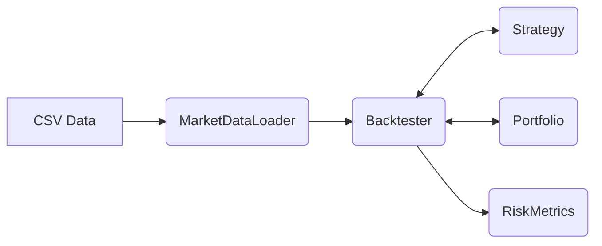
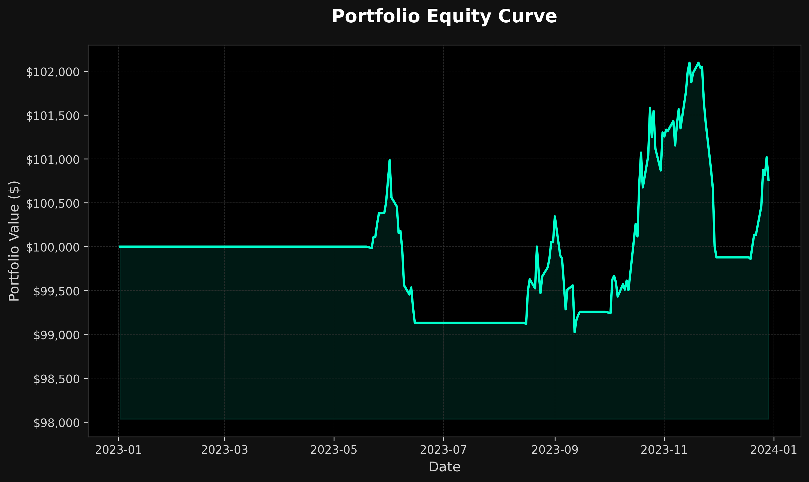

# C++ Algorithmic Trading Engine


A lightweight, high-performance backtesting engine for quantitative trading strategies, written entirely in modern C++17 with zero external dependencies.

I built this project to deepen my understanding of systems engineering, memory management, and financial software design. It demonstrates how to architect a modular system that cleanly separates data ingestion, strategy execution, state management, and post-trade analytics.

## System Architecture

The engine is designed as a single-threaded backtester that processes historical data sequentially. This guarantees deterministic results, avoids the complexity of deadlocks typical in live-trading simulations, and processes thousands of bars per second.



- **MarketDataLoader**: Parses historical CSV data into memory-efficient structs.
- **Strategy**: An abstract base class for algorithms. Computes indicators (SMA, RSI) and yields `BUY`, `SELL`, or `HOLD` signals.
- **Portfolio**: A state machine that tracks cash balances, executes simulated trades, deducts commissions, and marks positions to market.
- **RiskMetrics**: Post-hoc analytics engine calculating institutional metrics (Sharpe Ratio, Max Drawdown, Profit Factor).

## Key Features

- **Zero Dependencies**: Built strictly with the C++ Standard Library. No external libraries required for CSV parsing, testing, or building.
- **Pluggable Strategies**: New strategies can be added by simply inheriting from the `Strategy` base class and implementing the `evaluate()` method.
- **Built-in Indicators**: Includes from-scratch implementations of standard technical indicators like Simple Moving Averages and Relative Strength Index.
- **Institutional Metrics**: Accurately tracks equity curves and trade histories to compute annualized returns, win rates, and drawdowns.
- **Unit Tested**: Includes a custom lightweight test suite verifying indicator math and portfolio accounting logic.

## Building and Running

The project uses CMake and requires a compiler supporting C++17.

```bash
# Clone the repository
git clone <repository-url>
cd "Automated Stock Trading System"

# Build the engine and tests
mkdir build && cd build
cmake ..
make

# Run the tests
ctest --output-on-failure

# Run a backtest using sample data
./trading_engine ../data/sample_prices.csv --strategy sma
```

*Alternatively, you can run the provided example script from the project root:*
`./examples/run_backtest.sh`

## Output Example

```text
Loading market data from ../data/sample_prices.csv...
Loaded 260 price bars.
Running backtest with SMA Crossover (10/30)...

==================================================
BACKTEST RESULTS: SMA Crossover (10/30)
==================================================
Initial Capital:  $100000.00
Final Value:      $100761.46
Total Return:     0.76%
B&H Benchmark:    31.10%
Annualized Ret:   0.74%
Max Drawdown:     2.19% (99 bars)
Sharpe Ratio:     0.31

Trade Statistics:
Total Trades:     4
Winning Trades:   3
Losing Trades:    1
Win Rate:         75.00%
Average Win:      $559.69
Average Loss:     $852.28
Profit Factor:    1.97
==================================================
```



## What I Learned

- **Decoupling State from Logic**: Separating the raw data (`PriceBar`), the math functions (`Indicators::sma`), and the orchestration (`Backtester`) makes the system much easier to test and reason about.
- **C++ Memory & Lifetimes**: Using standard library containers and smart pointers correctly to avoid memory leaks while maintaining high throughput.
- **CMake Mastery**: Writing a clean `CMakeLists.txt` that automatically discovers sources, configures compiler flags, and integrates with CTest.
- **Financial Math Accuracy**: Dealing with floating-point precision when calculating PnL, tracking commissions, and avoiding look-ahead bias in the backtesting loop.

## Documentation

- [Architecture Notes](docs/architecture.md)
- [Interview Notes / Design Decisions](docs/interview-notes.md)
