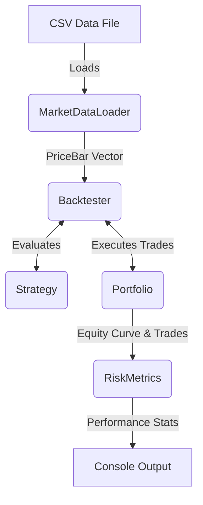

# System Architecture

The Automated Stock Trading System is designed as a single-threaded backtesting engine written in C++17. It focuses on clean separation of concerns between data loading, strategy evaluation, portfolio management, and post-trade analytics.

## Component Overview

## Core Components

### 1. MarketDataLoader
Parses historical price data from CSV files into memory. It converts raw string data into a `vector<PriceBar>` containing Date, Open, High, Low, Close, and Volume. The loader ensures all data is sorted chronologically before passing it to the engine.

### 2. Strategy
The `Strategy` base class defines the interface for all trading algorithms. 
- **`evaluate()`**: Called on every bar. Receives the current index and the full historical price vector. Returns a `Signal` (BUY, SELL, HOLD).
- **`reset()`**: Clears strategy state (like `has_position_`) between backtest runs.

Implemented strategies include:
- `SMACrossover`: Uses a fast and slow Simple Moving Average.
- `RSIMeanReversion`: Uses the Relative Strength Index to find overbought/oversold conditions.

### 3. Portfolio
Tracks the simulation's state, including available cash, current positions, and average entry prices. 
- **`executeTrade()`**: Simulates a fill at the given price, deducting commission, updating cash balances, and calculating realized PnL.
- **`getTotalValue()`**: Marks the portfolio to market based on the current bar's close price.

### 4. RiskMetrics
A post-hoc analytics module that processes the equity curve and trade log generated by the `Backtester`. It calculates standard institutional metrics:
- Annualized Return
- Max Drawdown
- Sharpe Ratio
- Win Rate & Profit Factor

### 5. Backtester
The main orchestration loop. For each price bar in the dataset:
1. Passes the data to the Strategy for evaluation.
2. If a BUY/SELL signal is generated, sizes the position and executes the trade via the Portfolio.
3. Records the trade details and the current total portfolio value.
4. At the end of the data, closes any open positions and passes the results to `RiskMetrics`.

## Design Decisions

- **Single-Threaded**: Unlike live trading systems that require complex mutexes and background polling threads, a backtester processes historical data sequentially. This guarantees deterministic results and eliminates deadlocks.
- **Zero External Dependencies**: The system relies purely on the C++ Standard Library. No external libraries are used for CSV parsing, JSON configuration, or testing, making the project trivial to clone and build on any platform.
- **Decoupled Indicators**: Technical indicators (SMA, RSI) are pure functions grouped in an `Indicators` namespace, making them easy to unit test independently of any Strategy or State.
